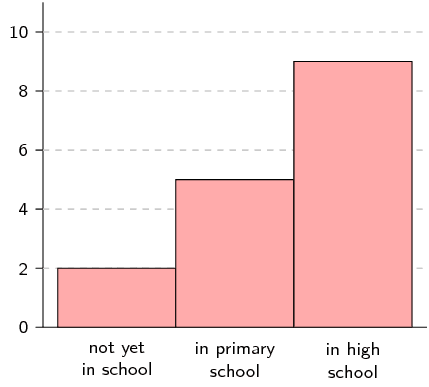
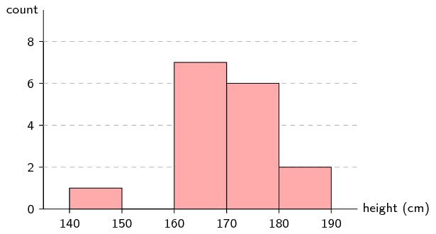
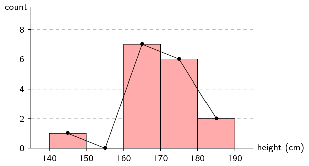
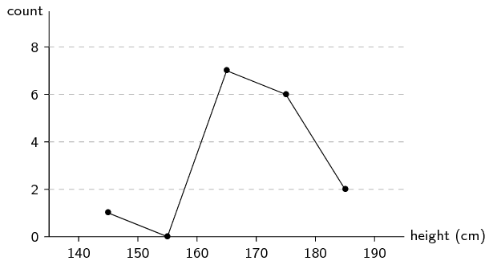
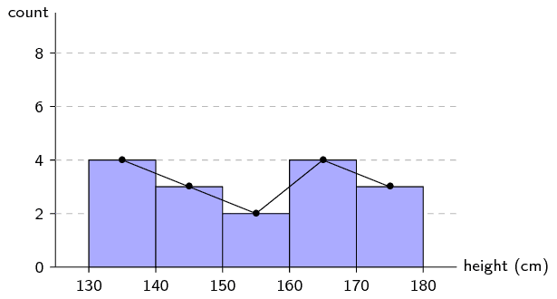
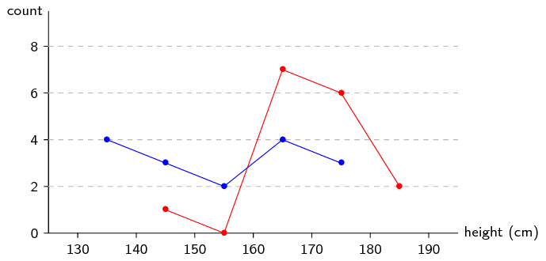
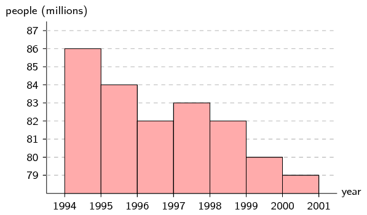
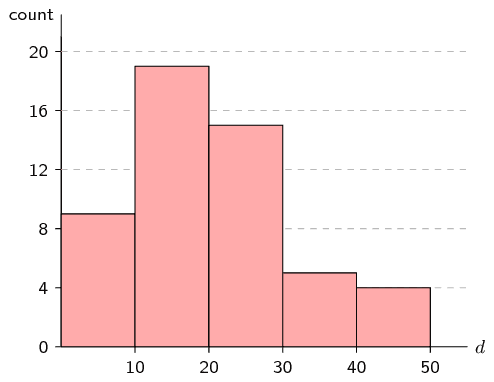
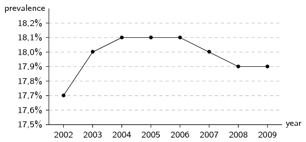

## 11.2 Histograms (EMBK5)

<QuizCard id="m11-11-02a" title="Interactive Exercise 11.3" question="A group of \(\text{20}\) students count the number of playing cards they each have. This is a histogram describing the data they collected: Student playing card count How many students have a number of playing cards in the following range: \[\begin{array}{c}\text{4} \leq \text{number of playing cards} <                 \text{8}\end{array}\]" options=[] answer=" 3 " hint="You should enter a number here. If you want to, you can use a space to separate thousands.                Example: 12 800,25 For scientific notation you need to use the multiply symbol                ( ∗ ) and the exponent symbol ( ^ ). For example 6,673 × 10 −11 should be written as: 6,673 ∗ 10^−11" explanation="Read the answer from the histogram We can read the answer directly from the histogram. The height of each bar shows                     the number of students in that class interval. We want to know the number of students                     who had \(\text{4}\) , \(\text{5}\) , \(\text{6}\) , or \(\text{7}\) playing cards.                     The class interval bar is shaded below. The number at the top of each bar shows the bar's frequency . That means the number                     of students who have a number of playing cards in the interval                     for that bar. The correct answer is: \(3\) . Submit your answer as:" />

A histogram is a graphical representation of how many times different, mutually exclusive events are
                        observed in an experiment.
                        To interpret a histogram, we find the events on the \(x\)-axis and the counts on the \(y\)-axis.
                        Each event has a rectangle that shows what its count (or frequency) is.

<Callout type="note" title="Note">
<VideoPlayer src="http://www.khanacademy.org/embed_video?v=4eLJGG2Ad30" title="Video: 23CK" />
</Callout>

<Callout type="tip" title="Worked example 4: Reading histograms">
**Question:**
Use the following histogram to determine the events that were recorded and the
                                        relative frequency of each event.
                                        Summarise your answer in a table.

**Determine the events:**
The events are shown on the \(x\)-axis.
                                        In this example we have “not yet in school”, “in primary
                                        school” and “in high school”.

**Read off the count for each event:**
The counts are shown on the \(y\)-axis and the height of each rectangle shows the
                                        frequency for each event.

- not yet in school: \(\text{2}\)
- in primary school: \(\text{5}\)
- in high school: \(\text{9}\)

**Calculate relative frequency:**
The relative frequency of an event in an experiment is the number of times that the
                                        event occurred divided by the total number of times that the experiment was
                                        completed.
                                        In this example we add up the frequencies for all the events to get a total
                                        frequency of \(\text{16}\).
                                        Therefore the relative frequencies are:

- not yet in school: \(\frac{2}{16} = \frac{1}{8}\)
- in primary school: \(\frac{5}{16}\)
- in high school: \(\frac{9}{16}\)

**Summarise:**
| Event | Count | Relative frequency |
| --- | --- | --- |
| not yet in school | \(\text{2}\) | \(\frac{1}{8}\) |
| in primary school | \(\text{5}\) | \(\frac{5}{16}\) |
| in high school | \(\text{9}\) | \(\frac{9}{16}\) |
</Callout>

To draw a histogram of a data set containing numbers, the numbers first have to be grouped.
                        Each group is defined by an interval.
                        We then count how many times numbers from each group appear in the data set and draw a histogram
                        using the counts.

<Callout type="tip" title="Worked example 5: Draw a histogram">
**Question:**
The following data represent the heights of \(\text{16}\) adults in centimetres.

                                \[\begin{array}{l}
                                \text{162}\ ;\ \text{168}\ ;\ \text{177}\ ;\ \text{147}\ ;\ \text{189}\ ;\ \text{171}\
                                ;\ \text{173}\ ;\ \text{168} \\
                                \text{178}\ ;\ \text{184}\ ;\ \text{165}\ ;\ \text{173}\ ;\ \text{179}\ ;\ \text{166}\
                                ;\ \text{168}\ ;\ \text{165}
                                \end{array}\]

Divide the data into \(\text{5}\) equal length intervals between \(\text{140}\)
                                        \(\text{cm}\) and \(\text{190}\) \(\text{cm}\) and draw a histogram.

**Determine intervals:**
To have \(\text{5}\) intervals of the same length between \(\text{140}\) and
                                        \(\text{190}\), we need and interval length of \(\text{10}\).
                                        Therefore the intervals are \((\text{140};\text{150}]\);
                                        \((\text{150};\text{160}]\); \((\text{160};\text{170}]\);
                                        \((\text{170};\text{180}]\); and \((\text{180};\text{190}]\).

**Count data:**
The following table summarises the number of data values in each of the intervals.

| Interval | \((\text{140};\text{150}]\) | \((\text{150};\text{160}]\) | \((\text{160};\text{170}]\) | \((\text{170};\text{180}]\) | \((\text{180};\text{190}]\) |
| --- | --- | --- | --- | --- | --- |
| Count | \(\text{1}\) | \(\text{0}\) | \(\text{7}\) | \(\text{6}\) | \(\text{2}\) |

**Draw the histogram:**

</Callout>

### Frequency polygons (EMBK6)

A frequency polygon is sometimes used to represent the same information as in a histogram.
                                A frequency polygon is drawn by using line segments to connect the middle of the top of
                                each bar in the histogram.
                                This means that the frequency polygon connects the coordinates at the centre of each
                                interval and the count in each interval.

<Callout type="tip" title="Worked example 6: Drawing a frequency polygon">
**Question:**
Use the histogram from the previous example to draw a frequency polygon of
                                                the same data.

**Draw the histogram:**
We already know that the histogram looks like this:

**Connect the tops of the rectangles:**
When we draw line segments between the tops of the rectangles in the
                                                histogram, we get the following picture:

**Draw final frequency polygon:**
Finally, we remove the histogram to show only the frequency polygon.

</Callout>

Frequency polygons are particularly useful for comparing two data sets.
                                Comparing two histograms would be more difficult since we would have to draw the
                                rectangles of the two data sets on top of each other.
                                Because frequency polygons are just lines, they do not pose the same problem.

<Callout type="tip" title="Worked example 7: Drawing frequency polygons">
**Question:**
Here is another data set of heights, this time of Grade \(\text{11}\)
                                                learners.

                                        \[\begin{array}{l}
                                        \text{132}\ ;\ \text{132}\ ;\ \text{156}\ ;\ \text{147}\ ;\ \text{162}\ ;\
                                        \text{168}\ ;\ \text{152}\ ;\ \text{174} \\
                                        \text{141}\ ;\ \text{136}\ ;\ \text{161}\ ;\ \text{148}\ ;\ \text{140}\ ;\
                                        \text{174}\ ;\ \text{174}\ ;\ \text{162}
                                        \end{array}\]

Draw the frequency polygon for this data set using the same interval length
                                                as in the previous example.
                                                Then compare the two frequency polygons on one graph to see the
                                                differences between the distributions.

**Frequency table:**
We first create the table of counts for the new data set.

| Interval | \((\text{130};\text{140}]\) | \((\text{140};\text{150}]\) | \((\text{150};\text{160}]\) | \((\text{160};\text{170}]\) | \((\text{170};\text{180}]\) |
| --- | --- | --- | --- | --- | --- |
| Count | \(\text{4}\) | \(\text{3}\) | \(\text{2}\) | \(\text{4}\) | \(\text{3}\) |

**Draw histogram and frequency polygon:**

**Compare frequency polygons:**
We draw the two frequency polygons on the same axes.
                                                The red line indicates the distribution over heights for adults and the
                                                blue line, for Grade \(\text{11}\) learners.

From this plot we can easily see that the heights for Grade \(\text{11}\)
                                                learners are distributed more towards the left (shorter) than adults.
                                                The learner heights also seem to be more evenly distributed between
                                                \(\text{130}\) and \(\text{180}\) \(\text{cm}\), whereas the adult
                                                heights are mostly between \(\text{160}\) and \(\text{180}\)
                                                \(\text{cm}\).
</Callout>

## Histograms

### Textbook Exercise 11.2

Use the histogram below to answer the following questions.
                                                        The histogram shows the number of people born around the world
                                                        each year.
                                                        The ticks on the \(x\)-axis are located at the start of each
                                                        year.

**Problem:**
How many people were born between the beginning of
                                                                \(\text{1 994}\) and the beginning of
                                                                \(\text{1 996}\)?

**Solution:**
\(86 + 84 = 170\) million

**Problem:**
Is the number people in the world population
                                                        increasing or decreasing? (Ignore the rate at which people are
                                                        dying for this question.)

**Solution:**
Even though the rate at which people are born seems to be
                                                                decreasing, there are still new people born every year
                                                                and so the world population is increasing.

**Problem:**
How many more people were born in \(\text{1 994}\) than
                                                                in \(\text{1 997}\)?

**Solution:**
\(86 - 83 = 3\) million

**Problem:**
In a traffic survey, a random sample of \(\text{50}\) motorists were
                                                        asked the distance they drove to work daily.
                                                        The results of the survey are shown in the table below.
                                                        Draw a histogram to represent the data.

| distance (\(\text{km}\)) | \(\text{0} < d \le \text{10}\) | \(\text{10} < d \le \text{20}\) | \(\text{20} < d \le \text{30}\) | \(\text{30} < d \le \text{40}\) | \(\text{40} < d \le \text{50}\) |
| --- | --- | --- | --- | --- | --- |
| count | \(\text{9}\) | \(\text{19}\) | \(\text{15}\) | \(\text{5}\) | \(\text{4}\) |

**Solution:**

**Problem:**
Below is data for the prevalence of HIV in South Africa.
                                                        HIV prevalence refers to the percentage of people between the
                                                        ages of \(\text{15}\) and \(\text{49}\) who are infected with
                                                        HIV.

| year | \(\text{2 002}\) | \(\text{2 003}\) | \(\text{2 004}\) | \(\text{2 005}\) | \(\text{2 006}\) | \(\text{2 007}\) | \(\text{2 008}\) | \(\text{2 009}\) |
| --- | --- | --- | --- | --- | --- | --- | --- | --- |
| prevalence | \(\text{17,7}\%\) | \(\text{18,0}\%\) | \(\text{18,1}\%\) | \(\text{18,1}\%\) | \(\text{18,1}\%\) | \(\text{18,0}\%\) | \(\text{17,9}\%\) | \(\text{17,9}\%\) |

Draw a frequency polygon of this data set.

**Solution:**

