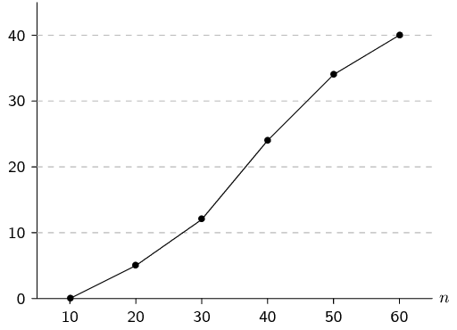
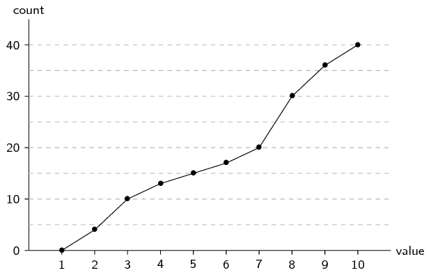
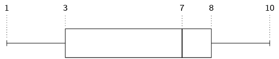
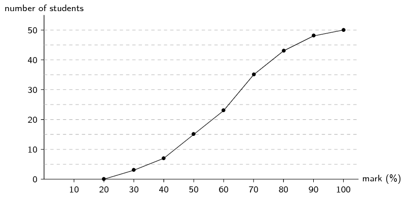
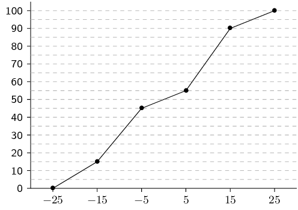
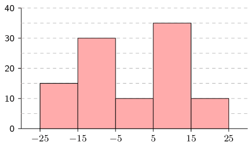
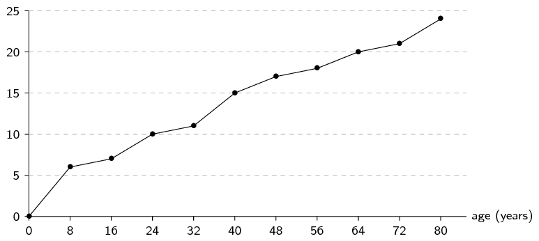
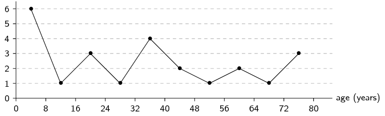

## 11.3 Ogives (EMBK7)

Cumulative histograms, also known as ogives, are graphs that can be used to determine how many data
                        values lie above or below a particular value in a data set.
                        The cumulative frequency is calculated from a frequency table, by adding each frequency to the
                        total of the frequencies of all data values before it in the data set.
                        The last value for the cumulative frequency will always be equal to the total number of data
                        values, since all frequencies will already have been added to the previous total.

An ogive is drawn by

- plotting the beginning of the first interval at a \(y\)-value of zero;
- plotting the end of every interval at the \(y\)-value equal to the cumulative count for
                                  that interval; and
- connecting the points on the plot with straight lines.

                In this way, the end of the final interval will always be at the total number of data since we will have
                added up across all intervals.

<Callout type="tip" title="Worked example 8: Cumulative frequencies and ogives">
**Question:**
Determine the cumulative frequencies of the following grouped data and complete the
                                        table below.
                                        Use the table to draw an ogive of the data.

| Interval | Frequency | Cumulative frequency |
| --- | --- | --- |
| \(10 < n \le 20\) | \(\text{5}\) |  |
| \(20 < n \le 30\) | \(\text{7}\) |  |
| \(30 < n \le 40\) | \(\text{12}\) |  |
| \(40 < n \le 50\) | \(\text{10}\) |  |
| \(50 < n \le 60\) | \(\text{6}\) |  |

**Compute cumulative frequencies:**
To determine the cumulative frequency, we add up the frequencies going down the
                                        table.
                                        The first cumulative frequency is just the same as the frequency, because we are
                                        adding it to zero.
                                        The final cumulative frequency is always equal to the sum of all the
                                        frequencies.
                                        This gives the following table:

| Interval | Frequency | Cumulative frequency |
| --- | --- | --- |
| \(10 < n \le 20\) | \(\text{5}\) | \(\text{5}\) |
| \(20 < n \le 30\) | \(\text{7}\) | \(\text{12}\) |
| \(30 < n \le 40\) | \(\text{12}\) | \(\text{24}\) |
| \(40 < n \le 50\) | \(\text{10}\) | \(\text{34}\) |
| \(50 < n \le 60\) | \(\text{6}\) | \(\text{40}\) |

**Plot the ogive:**
The first coordinate in the plot always starts at a \(y\)-value of \(\text{0}\)
                                        because we always start from a count of zero.
                                        So, the first coordinate is at \((10;0)\) — at the beginning of the first
                                        interval.
                                        The second coordinate is at the end of the first interval (which is also the
                                        beginning of the second interval) and at the first cumulative count, so
                                        \((20;5)\).
                                        The third coordinate is at the end of the second interval and at the second
                                        cumulative count, namely \((30;12)\), and so on.

Computing all the coordinates and connecting them with straight lines gives the
                                        following ogive.

</Callout>

<QuizCard id="m11-11-03a" title="Interactive Exercise 11.5" question="Adapted from DBE Nov 2016 Grade 11, P2, Q2 Maths formulas The table below shows the time (in minutes) that \(\text{90}\) people spent in total on their cellphones over \(\text{2}\) days. 				Complete the indicated values in the cumulative frequency column." options=[] answer="21, 31, 46, 90" hint="You should enter a number here. If you want to, you can use a space to separate thousands.                Example: 12 800,25 For scientific notation you need to use the multiply symbol                ( ∗ ) and the exponent symbol ( ^ ). For example 6,673 × 10 −11 should be written as: 6,673 ∗ 10^−11" explanation="Add each frequency value to the sum of all the frequency values before it The word cumulative means 'growing by adding one after the other'. 					The cumulative frequency of a class is the frequency for that class, 					added to the frequency of all the previous classes. 					So, the cumulative frequency of the last class is equal to the whole sample size. Add each frequency value to the sum of all the frequency values before it in the table, 					to get the cumulative frequency. Frequency Cumulative frequency \(\text{21}\) \(0 + 21 = 21\) \(\text{10}\) \(21 + 10 = 31\) \(\text{15}\) \(31 + 15 = 46\) \(\text{44}\) \(46 + 44 = \mathbf{90}\) TIP: On paper you would fill in the whole column of the table. 					Then check that the cumulative frequency of the last class is equal to the whole sample size. 					Here the 'last cumulative frequency value' is equal to \(\mathbf{90}\) , the total number of people. 					So all is good. Submit your answer as: and and and" />

<QuizCard id="m11-11-03a" title="Interactive Exercise 11.5" question="The table below shows frequencies and cumulative frequencies for a set of \(\text{17}\) data values. The third row is shaded green. Interval Frequency Cumulative frequency \(0 \leq x < 6\) \(\text{5}\) \(\text{5}\) \(6 \leq x < 12\) \(\text{4}\) \(\text{9}\) \(12 \leq x < 18\) \(\text{3}\) \(\text{12}\) \(18 \leq x < 24\) \(\text{2}\) \(\text{14}\) \(24 \leq x < 30\) \(\text{3}\) \(\text{17}\) The data in the table make the ogive (cumulative frequency curve) below. There are four points on the graph, labelled \(A\) , \(B\) , \(C\) , and \(D\) . Which of the points on the ogive corresponds to the third row in the table above?" options=["A", "B", "C", "D"] answer="C" hint="" explanation="Use the interval and the cumulative frequency for the third row An ogive is a line graph which shows the cumulative frequencies for a data set. Cumulative frequencies are a running total of values. In this question, the table shows us the cumulative frequencies (and the frequencies) for a data set which is split into five intervals. Each row in the table corresponds to one point on the ogive. For each of those points: the \(x\) -coordinate is the upper limit of the interval the \(y\) -coordinate is the cumulative frequency for that interval In this case we are interested in the third row, which is: Interval Frequency Cumulative frequency \(12 \leq x < 18\) \(\text{3}\) \(\text{12}\) So the point we are looking for is at \(x = 18\) and \(y = 12\) . Which point has the coordinates \((18; 12)\) ? NOTE: The meaning of Point \(C\) is that from \( x = 0\) up to \(x = 18\) there are a total of \(\text{12}\) data values in the data set. Those values are not all in the third interval - they are spread out amongst the first \(\text{3}\) intervals. Row \(\text{3}\) tells us that there must be a point at the coordinates \((18; 12)\) , which is Point \(C\) . Submit your answer as: C" />

Ogives do look similar to frequency polygons, which we saw earlier.
                        The most important difference between them is that an ogive is a plot of
                        **cumulative** values, whereas a frequency polygon is a plot of the values
                        themselves.
                        So, to get from a frequency polygon to an ogive, we would add up the counts as we move from left
                        to right in the graph.

Ogives are useful for determining the median, percentiles and five number summary of data.
                        Remember that the median is simply the value in the middle when we order the data.
                        A quartile is simply a quarter of the way from the beginning or the end of an ordered data set.
                        With an ogive we already know how many data values are above or below a certain point, so it is
                        easy to find the middle or a quarter of the data set.

<Callout type="tip" title="Worked example 9: Ogives and the five number summary">
**Question:**
Use the following ogive to compute the five number summary of the data.
                                        Remember that the five number summary consists of the minimum, all the quartiles
                                        (including the median) and the maximum.

**Find the minimum and maximum:**
The minimum value in the data set is \(\text{1}\) since this is where the ogive
                                        starts on the horizontal axis.
                                        The maximum value in the data set is \(\text{10}\) since this is where the ogive
                                        stops on the horizontal axis.

**Find the quartiles:**
The quartiles are the values that are \(\frac{1}{4}\), \(\frac{1}{2}\) and
                                        \(\frac{3}{4}\) of the way into the ordered data set.
                                        Here the counts go up to \(\text{40}\), so we can find the quartiles by looking
                                        at the values corresponding to counts of \(\text{10}\), \(\text{20}\) and
                                        \(\text{30}\).
                                        On the ogive a count of

- \(\text{10}\) corresponds to a value of \(\text{3}\) (first quartile);
- \(\text{20}\) corresponds to a value of \(\text{7}\) (second quartile); and
- \(\text{30}\) corresponds to a value of \(\text{8}\) (third quartile).

**Write down the five number summary:**
The five number summary is \((1; 3; 7; 8; 10)\).
                                        The box-and-whisker plot of this data set is given below.

</Callout>

## Ogives

### Textbook Exercise 11.3

Use the ogive to answer the questions below.

**Problem:**
How many students got between \(\text{50}\%\) and
                                                                \(\text{70}\%\)?

**Solution:**
The cumulative plot shows that \(\text{15}\) students got
                                                                below \(\text{50}\%\) and \(\text{35}\) students got
                                                                below \(\text{70}\%\).
                                                                Therefore \(35-15=\text{20}\) students got between
                                                                \(\text{50}\%\) and \(\text{70}\%\).

**Problem:**
How many students got at least \(\text{70}\%\)?

**Solution:**
The cumulative plot shows that \(\text{35}\) students got
                                                                below \(\text{70}\%\) and that there are \(\text{50}\)
                                                                students in total.
                                                                Therefore \(50-35=\text{15}\) students got at least
                                                                (greater than or equal to) \(\text{70}\%\).

**Problem:**
Compute the average mark for this class, rounded to
                                                        the nearest integer.

**Solution:**
To compute the average, we first need to use the ogive to
                                                                determine the frequency of each interval.
                                                                The frequency of an interval is the difference between
                                                                the cumulative counts at the top and bottom of the
                                                                interval on the ogive.
                                                                It might be difficult to read the exact cumulative count
                                                                for some of the points on the ogive.
                                                                But since the final answer will be rounded to the
                                                                nearest integer, small errors in the counts will not
                                                                make a difference.
                                                                The table below summarises the counts.

| Interval | \([20,30)\) | \([30,40)\) | \([40,50)\) | \([50,60)\) | \([60,70)\) | \([70,80)\) | \([80,90)\) | \([90,100)\) |
| --- | --- | --- | --- | --- | --- | --- | --- | --- |
| Count | \(\text{3}\) | \(\text{4}\) | \(\text{8}\) | \(\text{8}\) | \(\text{12}\) | \(\text{8}\) | \(\text{5}\) | \(\text{2}\) |

The average is then the centre of each interval, weighted by
                                                                the count in that interval.
                                                                \[\frac{3 \times 25 + 4 \times 35 + 8 \times 45 + 8
                                                                \times 55 + 12 \times 65 + 8 \times 75 + 5 \times 85 + 2
                                                                \times 95}{3+4+8+8+12+8+5+2} = \text{60,2}\]

                                                                The average mark, rounded to the nearest integer, is
                                                                \(\text{60}\%\).

**Problem:**
Draw the histogram corresponding to this ogive.

**Solution:**
To draw the histogram we need to determine the count in each
                                                        interval.

Firstly, we can find the intervals by looking where the points are
                                                        plotted on the ogive.
                                                        Since the points are at \(x\)-coordinates of \(-\text{25}\);
                                                        \(-\text{15}\); \(-\text{5}\); \(\text{5}\); \(\text{15}\) and
                                                        \(\text{25}\), it means that the intervals are \([-25;-15)\),
                                                        etc.

To get the count in each interval we subtract the cumulative count at
                                                        the start of the interval from the cumulative count at the end
                                                        of the interval.

| Interval | \([-25;-15)\) | \([-15;-5)\) | \([-5;5)\) | \([5;15)\) | \([15;25)\) |
| --- | --- | --- | --- | --- | --- |
| Count | \(\text{15}\) | \(\text{30}\) | \(\text{10}\) | \(\text{35}\) | \(\text{10}\) |

From these counts we can draw the following histogram:

The following data set lists the ages of \(\text{24}\) people.

\(\text{2}\); \(\text{5}\); \(\text{1}\); \(\text{76}\);
                                                        \(\text{34}\); \(\text{23}\); \(\text{65}\); \(\text{22}\);
                                                        \(\text{63}\); \(\text{45}\); \(\text{53}\); \(\text{38}\)

\(\text{4}\); \(\text{28}\); \(\text{5}\); \(\text{73}\);
                                                        \(\text{79}\); \(\text{17}\); \(\text{15}\); \(\text{5}\);
                                                        \(\text{34}\); \(\text{37}\); \(\text{45}\); \(\text{56}\)

Use the data to answer the following questions.

**Problem:**
Using an interval width of \(\text{8}\) construct a
                                                                cumulative frequency plot.

**Solution:**
The table below shows the number of people in each age
                                                                bracket of width \(\text{8}\).

| Interval | \([0;8)\) | \([8;16)\) | \([16;24)\) | \([24;32)\) | \([32;40)\) |
| --- | --- | --- | --- | --- | --- |
| Count | \(\text{6}\) | \(\text{1}\) | \(\text{3}\) | \(\text{1}\) | \(\text{4}\) |
| Cumulative | \(\text{6}\) | \(\text{7}\) | \(\text{10}\) | \(\text{11}\) | \(\text{15}\) |
| Interval | \([40;48)\) | \([48;56)\) | \([56;64)\) | \([64;72)\) | \([72;80)\) |
| Count | \(\text{2}\) | \(\text{1}\) | \(\text{2}\) | \(\text{1}\) | \(\text{3}\) |
| Cumulative | \(\text{17}\) | \(\text{18}\) | \(\text{20}\) | \(\text{21}\) | \(\text{24}\) |

From this table we can draw the cumulative frequency plot:

**Problem:**
How many are below \(\text{30}\)?

**Solution:**
\(\text{11}\) people

**Problem:**
How many are below \(\text{60}\)?

**Solution:**
\(\text{19}\) people

**Problem:**
Giving an explanation, state below what value the bottom
                                                                \(\text{50}\%\) of the ages fall.

**Solution:**
This question is asking for the median of the data set. The
                                                                median is, by definition, the value below which
                                                                \(\text{50}\%\) of the data lie. Since there are
                                                                \(\text{24}\) values, the median lies between the middle
                                                                two values, giving \(\text{34}\).

**Problem:**
Below what value do the bottom \(\text{40}\%\) fall?

**Solution:**
There are \(\text{24}\) values.
                                                                By drawing a number line, as we do for determining
                                                                quartiles, we can see that the \(\text{40}\%\) point is
                                                                between the tenth and eleventh values.
                                                                The tenth value is \(\text{23}\) and the eleventh value
                                                                is \(\text{28}\).
                                                                Therefore \(\text{40}\%\) of the values lie below
                                                                \(\dfrac{23+28}{2} = \text{25,5}\).

**Problem:**
Construct a frequency polygon.

**Solution:**
We already have all the values needed to construct the
                                                                frequency polygon in the table of values above.

The weights of bags of sand in grams is given below (rounded to the
                                                        nearest tenth):

\(\text{50,1}\); \(\text{40,4}\); \(\text{48,5}\); \(\text{29,4}\);
                                                        \(\text{50,2}\); \(\text{55,3}\); \(\text{58,1}\);
                                                        \(\text{35,3}\); \(\text{54,2}\); \(\text{43,5}\)

\(\text{60,1}\); \(\text{43,9}\); \(\text{45,3}\); \(\text{49,2}\);
                                                        \(\text{36,6}\); \(\text{31,5}\); \(\text{63,1}\);
                                                        \(\text{49,3}\); \(\text{43,4}\); \(\text{54,1}\)

**Problem:**
Decide on an interval width and state what you
                                                        observe about your choice.

**Solution:**
Learner-dependent answer.

**Problem:**
Give your lowest interval.

**Solution:**
Learner-dependent answer.

**Problem:**
Give your highest interval.

**Solution:**
Learner-dependent answer.

**Problem:**
Construct a cumulative frequency graph and a
                                                        frequency polygon.

**Solution:**
Learner-dependent answer.

**Problem:**
Below what value do \(\text{53}\%\) of the cases fall?

**Solution:**
\(\text{49,25}\)

**Problem:**
Below what value of \(\text{60}\%\) of the cases fall?

**Solution:**
\(\text{49,7}\)
