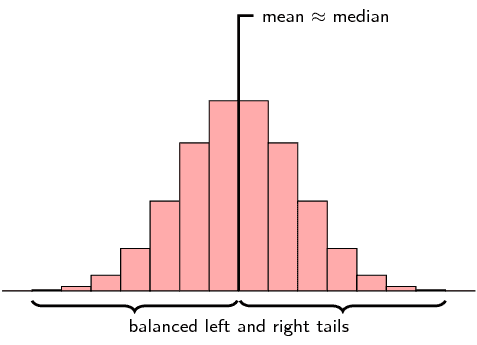
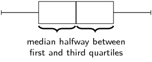
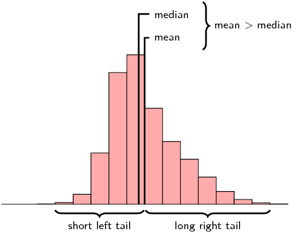
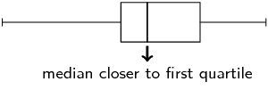
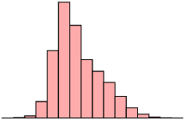
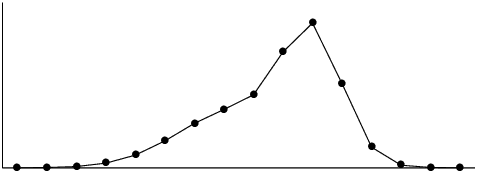

## 11.5 Symmetric and skewed data (EMBKD)

We are now going to classify data sets into \(\text{3}\) categories that describe the shape of the
                        data distribution: symmetric, left skewed, right skewed.
                        We can use this classification for any data set, but here we will look only at distributions
                        with one peak.
                        Most of the data distributions that you have seen so far have only one peak, so the plots in
                        this section should look familiar.

Distributions with one peak are called **unimodal distributions**.
                        Unimodal literally means having one mode.
                        (Remember that a mode is a maximum in the distribution.)

### Symmetric distributions (EMBKF)

A symmetric distribution is one where the left and right hand sides of the distribution are
                                roughly equally balanced around the mean.
                                The histogram below shows a typical symmetric distribution.

For symmetric distributions, the mean is approximately equal to the median.
                                The **tails** of the distribution are the parts to the left and to the
                                right, away from the mean.
                                The tail is the part where the counts in the histogram become smaller.
                                For a symmetric distribution, the left and right tails are equally balanced, meaning
                                that they have about the same length.

The figure below shows the box and whisker diagram for a typical symmetric data set.

Another property of a symmetric distribution is that its median (second quartile) lies in the
                                middle of its first and third quartiles.
                                Note that the whiskers of the plot (the minimum and maximum) do not have to be equally
                                far away from the median.
                                In the next section on outliers, you will see that the minimum and maximum values do not
                                necessarily match the rest of the data distribution well.

### Skewed (EMBKG)

A distribution that is **skewed right** (also known as **positively
                                        skewed**) is shown below.

Now the picture is not symmetric around the mean anymore.
                                For a right skewed distribution, the mean is typically greater than the median.
                                Also notice that the tail of the distribution on the right hand (positive) side is
                                longer than on the left hand side.

From the box and whisker diagram we can also see that the median is closer to the first
                                quartile than the third quartile.
                                The fact that the right hand side tail of the distribution is longer than the left can
                                also be seen.

A distribution that is skewed left has exactly the opposite characteristics of one that is
                                skewed right:

- the mean is typically less than the median;
- the tail of the distribution is longer on the left hand side than on the right hand
                                          side; and
- the median is closer to the third quartile than to the first quartile.

The table below summarises the different categories visually.

| Symmetric | Skewed right (positive) | Skewed left (negative) |
| --- | --- | --- |

## Symmetric and skewed data

### Textbook Exercise 11.5

**Problem:**
Is the following data set symmetric, skewed right or skewed left?
                                                        Motivate your answer.

\(\text{27}\) ; \(\text{28}\) ; \(\text{30}\) ; \(\text{32}\) ;
                                                        \(\text{34}\) ; \(\text{38}\) ; \(\text{41}\) ; \(\text{42}\) ;
                                                        \(\text{43}\) ; \(\text{44}\) ; \(\text{46}\) ; \(\text{53}\) ;
                                                        \(\text{56}\) ; \(\text{62}\)

**Solution:**
The statistics of the data set are

- mean: \(\text{41,1}\);
- first quartile: \(\text{33}\);
- median: \(\text{41,5}\);
- third quartile: \(\text{45}\).

                                                We can conclude that the data set is skewed left for two reasons.

- The mean is less than the median. There is only a very small
                                                                  difference between the mean and median, so this is not a
                                                                  very strong reason.
- A better reason is that the median is closer to the third
                                                                  quartile than the first quartile.

State whether each of the following data sets are symmetric, skewed
                                                        right or skewed left.

**Problem:**
A data set with this histogram:

**Solution:**
skewed right

**Problem:**
A data set with this box and whisker plot:

**Solution:**
skewed right

**Problem:**
A data set with this frequency polygon:

**Solution:**
skewed left

**Problem:**
The following data set:

\(\text{11,2}\) ; \(\text{5}\) ; \(\text{9,4}\) ;
                                                                \(\text{14,9}\) ; \(\text{4,4}\) ; \(\text{18,8}\) ;
                                                                \(-\text{0,4}\) ; \(\text{10,5}\) ; \(\text{8,3}\) ;
                                                                \(\text{17,8}\)

**Solution:**
The statistics of the data set are

- mean: \(\text{9,99}\);
- first quartile: \(\text{6,65}\);
- median: \(\text{9,95}\);
- third quartile: \(\text{13,05}\).

                                                        Note that we get contradicting indications from the different
                                                        ways of determining whether the data is skewed right or left.

- The mean is slightly greater than the median. This
                                                                          would indicate that the data set is skewed
                                                                          right.
- The median is slightly closer to the third quartile
                                                                          than the first quartile. This would indicate
                                                                          that the data set is skewed left.

                                                        Since these differences are so small and since they contradict
                                                        each other, we conclude that the data set is symmetric.

**Problem:**
Two data sets have the same range and interquartile range, but one is
                                                        skewed right and the other is skewed left.
                                                        Sketch the box and whisker plot for each of these data sets.
                                                        Then, invent data (\(\text{6}\) points in each data set) that
                                                        matches the descriptions of the two data sets.

**Solution:**
Learner-dependent answer.
