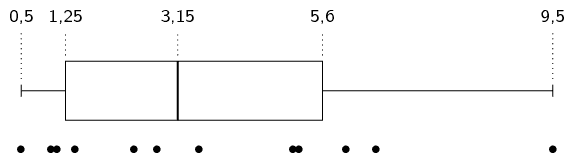
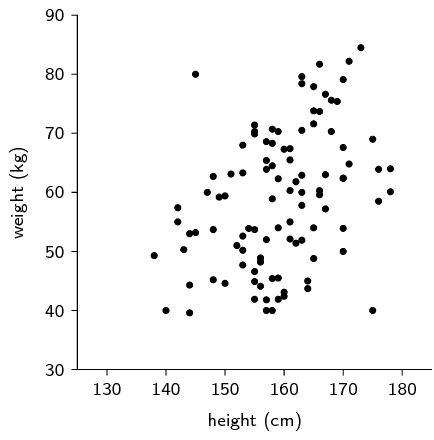
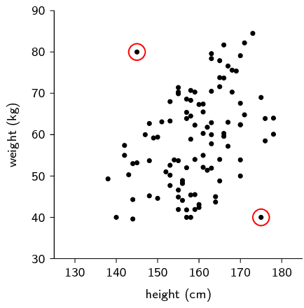
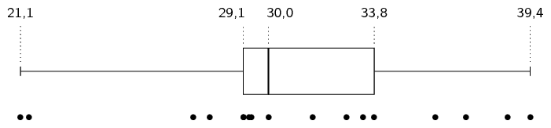
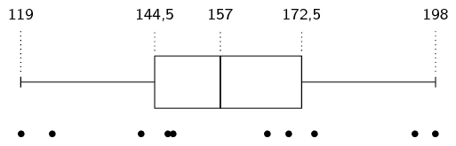
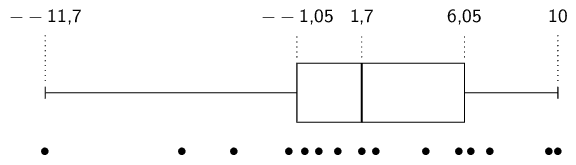
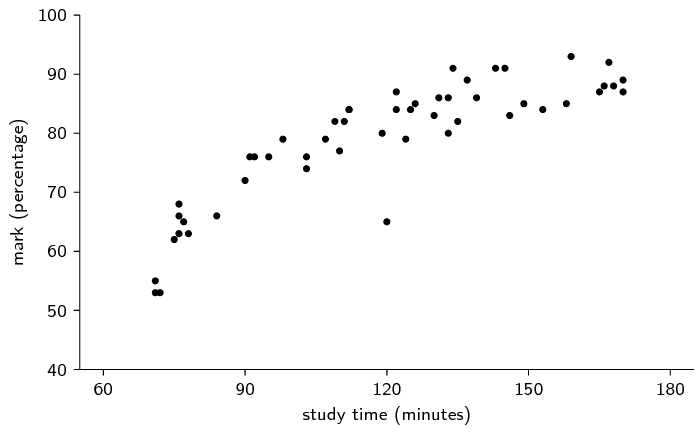
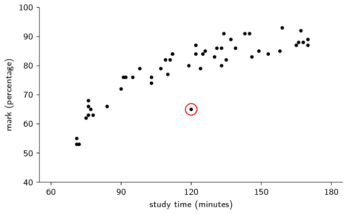

## 11.6 Identification of outliers (EMBKH)

<QuizCard id="m11-11-06a" title="Interactive Exercise 11.11" question="Adapted from DBE Nov 2016 Grade 11, P2, Q1 Maths formulas Here is a list of data: \[                 \begin{array}{ccccccc}             		\color{black}{2} & 6 & 14 & 15 & 17 & 18 & \color{black}{21}                 \end{array}             \] The box and whisker diagram below represents this data." options=["skewed to the right", "skewed to the left", "symmetric"] answer="1, 1, 3" hint="" explanation="Look at the skewness of the data The box and whisker diagram gives us a picture of the spread of the data. We need to look at both the                 	box part of the diagram and the whisker parts of the diagram in order to determine the skewness. NOTE: If there is an outlier, how do the whiskers look? The data is skewed to the left. The data is skewed to the right. If there is no outlier, look at the box part of the diagram: The data is symmetric. The data is skewed to the left. The data is skewed to the right. We can see that the left part of the box is much bigger because the median                     is closer to \(Q_3\) than to \(Q_1\) , so we say that the data set is skewed to the left . Look at the maximum and minimum values An outlier is a value in the data set that 'sticks out' because it is much smaller or much bigger than most of the other values in the data set. Our data values are already ordered: \[ 				    \begin{array}{ccccccc} 						\color{red}{2} & 6 & 14 & 15 & 17 & 18 & \color{blue}{21}					 				    \end{array} 				\] The minimum value is \(\color{red}{\text{2}}\) and the maximum value is \(\color{blue}{\text{21}}\) . Is the minimum much smaller than the other values? Is the maximum much larger than the other values? There is a rule about what qualifies as much smaller and much bigger . Identify an outlier An outlier is an outlier because it 'sticks out'. It is not close to the other values. The rule for checking if a value is an outlier is that it must be: more than \(\text{1,5} \times IQR\) to the left of \(Q_1\) ; or more than \(\text{1,5} \times IQR\) to the right of \(Q_3\) Look at the information shown on the box and whisker diagram. Determine the interquartile range: \[                     \begin{aligned}                         IQR &= Q_3 - Q_1 \\                             &= \text{18} - \text{6} \\                             &= \text{12}                     \end{aligned}                 \] An outlier on the left-hand side would need to be less than : \[ 				    \begin{aligned} 						 &Q_1 - \text{1,5} \times IQR \\ 						 &=6 - (\text{1,5} \times 12) \\ 						 &=-\text{12} 				    \end{aligned} 				\] An outlier on the right-hand side would need to be more than : \[ 				    \begin{aligned} 						  & Q_3 + \text{1,5} \times IQR \\ 						  &= 18 + (\text{1,5} \times 12) \\ 						  &= \text{36} 				    \end{aligned} 				\] So to answer the questions we posed: Is the minimum much smaller than the other values? No . Is the maximum much larger than the other values? No . There are no values less than \(-\text{12}\) and no values more than \(\text{36}\) , so there are no outliers in this data set. An example of an outlier on the right-hand side could be any value more than than \(\text{36}\) , such as one of these: \(\text{37}\) , \(\text{38}\) , \(\text{39}\) , \(\text{40}\) , or \(\text{41}\) . So the correct choice is \(\text{40}\) . Submit your answer as: skewed to the left and There is no outlier, but an example outlier would be \(x\) and \(\text{40}\)" />

An outlier in a data set is a value that is far away from the rest of the values in the data set.
      In a box and whisker diagram, outliers are usually close to the whiskers of the diagram.
      This is because the centre of the diagram represents the data between the first and third quartiles, which is
      where \(\text{50}\%\) of the data lie, while the whiskers represent the extremes — the minimum and maximum
      — of the data.

<Callout type="tip" title="Worked example 12: Identifying outliers">
**Question:**
Find the outliers in the following data set by drawing a box and whisker diagram and locating the data values
          on the diagram.

\(\text{0,5}\) ; \(\text{1}\) ; \(\text{1,1}\) ; \(\text{1,4}\) ; \(\text{2,4}\) ; \(\text{2,8}\) ;
          \(\text{3,5}\) ; \(\text{5,1}\) ; \(\text{5,2}\) ; \(\text{6}\) ; \(\text{6,5}\) ; \(\text{9,5}\)

**Determine the five number summary:**
The minimum of the data set is \(\text{0,5}\).
          The maximum of the data set is \(\text{9,5}\).
          Since there are \(\text{12}\) values in the data set, the median lies between the sixth and seventh values,
          making it equal to \(\frac{\text{2,8}+\text{3,5}}{2} = \text{3,15}\).
          The first quartile lies between the third and fourth values, making it equal to
          \(\frac{\text{1,1}+\text{1,4}}{2} = \text{1,25}\).
          The third quartile lies between the ninth and tenth values, making it equal to \(\frac{\text{5,2}+\text{6}}{2}
          = \text{5,6}\).

**Draw the box and whisker diagram:**

In the figure above, each value in the data set is shown with a black dot.

**Find the outliers:**
From the diagram we can see that most of the values are between \(\text{1}\) and \(\text{6}\).
          The only value that is very far away from this range is the maximum at \(\text{9,5}\).
          Therefore \(\text{9,5}\) is the only outlier in the data set.
</Callout>

You should also be able to identify outliers in plots of two variables.
      A **scatter plot** is a graph that shows the relationship between two random variables.
      We call these data **bivariate** (literally meaning two variables) and we plot the data for two
      different variables on one set of axes.
      The following example shows what a typical scatter plot looks like.
      For Grade \(\text{11}\) you do not need to learn how to draw these \(\text{2}\)-dimensional scatter plots, but you
      should be able to identify outliers on them.
      As before, an outlier is a value that is far removed from the main distribution of data.

<Callout type="tip" title="Worked example 13: Scatter plot">
**Question:**
We have a data set that relates the heights and weights of a number of people.
          The height is the first variable and its value is plotted along the horizontal axis.
          The weight is the second variable and its value is plotted along the vertical axis.
          The data values are shown on the plot below.
          Identify any outliers on the scatter plot.

We inspect the plot visually and notice that there are two points that lie far away from the main data
        distribution.
        These two points are circled in the plot below.

</Callout>

## Outliers

### Textbook Exercise 11.6

For each of the following data sets, draw a box and whisker diagram and determine whether there are any
              outliers in the data.

**Problem:**
\(\text{30}\) ; \(\text{21,4}\) ; \(\text{39,4}\) ; \(\text{33,4}\) ; \(\text{21,1}\) ; \(\text{29,3}\)
                ; \(\text{32,8}\) ; \(\text{31,6}\) ; \(\text{36}\) ;

\(\text{27,9}\) ; \(\text{27,3}\) ; \(\text{29,4}\) ; \(\text{29,1}\) ; \(\text{38,6}\) ;
                \(\text{33,8}\) ; \(\text{29,1}\) ; \(\text{37,1}\)

**Solution:**
Below is the box-and-whisker diagram of the data as well as dots representing the data themselves.
                Note that learners do not neeed to draw the dots, but this helps us to see that there are two outliers
                on the left.

**Problem:**
\(\text{198}\) ; \(\text{166}\) ; \(\text{175}\) ; \(\text{147}\) ; \(\text{125}\) ; \(\text{194}\) ;
                \(\text{119}\) ; \(\text{170}\) ; \(\text{142}\) ; \(\text{148}\)

**Solution:**

There are no outliers.

**Problem:**
\(\text{7,1}\) ; \(\text{9,6}\) ; \(\text{6,3}\) ; \(-\text{5,9}\) ; \(\text{0,7}\) ; \(-\text{0,1}\) ;
                \(\text{4,4}\) ; \(-\text{11,7}\) ; \(\text{10}\) ; \(\text{2,3}\) ; \(-\text{3,7}\) ; \(\text{5,8}\) ;
                \(-\text{1,4}\) ; \(\text{1,7}\) ; \(-\text{0,7}\)

**Solution:**

There is one outlier on the left.

**Problem:**
A class's results for a test were recorded along with the amount of time spent studying for it.
              The results are given below.
              Identify any outliers in the data.

**Solution:**
There is one outlier, marked in red below.

