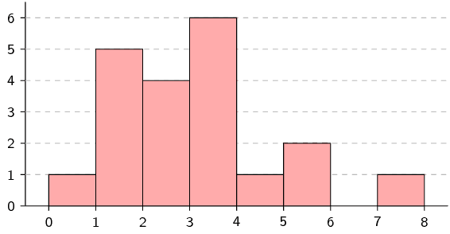
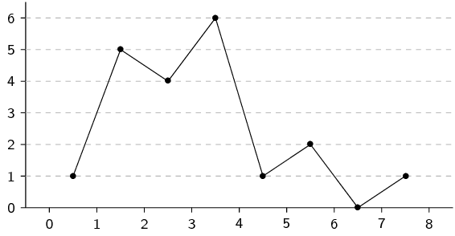
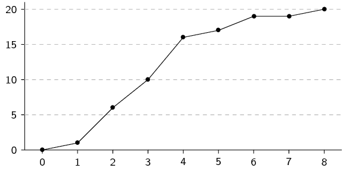
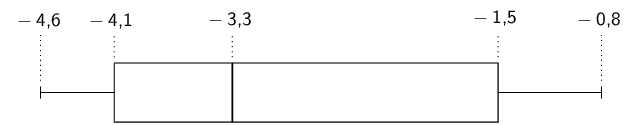
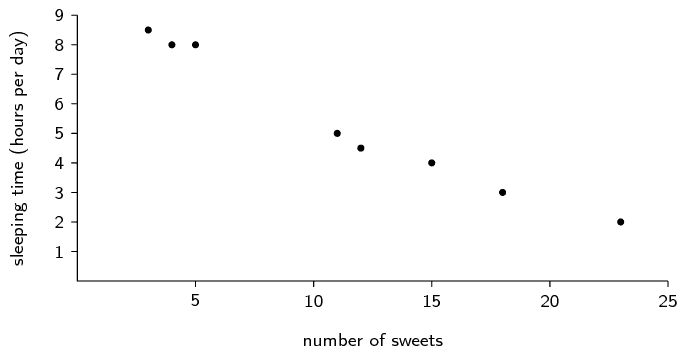
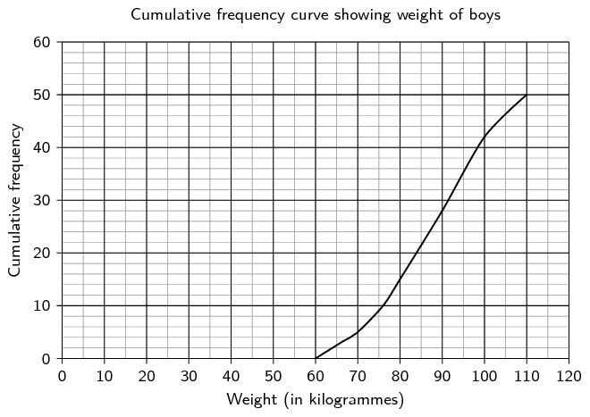
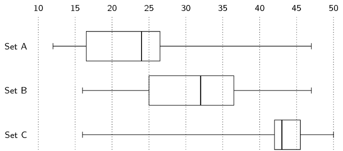

## End of chapter exercises

### Textbook Exercise 11.7

**Problem:**
Draw a histogram, frequency polygon and ogive of the following data set.
                                                To count the data, use intervals with a width of \(\text{1}\), starting
                                                from \(\text{0}\).

\(\text{0,4}\) ; \(\text{3,1}\) ; \(\text{1,1}\) ; \(\text{2,8}\) ;
                                                \(\text{1,5}\) ; \(\text{1,3}\) ; \(\text{2,8}\) ; \(\text{3,1}\) ;
                                                \(\text{1,8}\) ; \(\text{1,3}\) ;

\(\text{2,6}\) ; \(\text{3,7}\) ; \(\text{3,3}\) ; \(\text{5,7}\) ;
                                                \(\text{3,7}\) ; \(\text{7,4}\) ; \(\text{4,6}\) ; \(\text{2,4}\) ;
                                                \(\text{3,5}\) ; \(\text{5,3}\)

**Solution:**
We first organise the data into a table using an interval width of
                                                \(\text{1}\), showing the count in each interval as well as the
                                                cumulative count across intervals.

| Interval | \([\text{0};\text{1})\) | \([\text{1};\text{2})\) | \([\text{2};\text{3})\) | \([\text{3};\text{4})\) | \([\text{4};\text{5})\) | \([\text{5};\text{6})\) | \([\text{6};\text{7})\) | \([\text{7};\text{8})\) |
| --- | --- | --- | --- | --- | --- | --- | --- | --- |
| Count | \(\text{1}\) | \(\text{5}\) | \(\text{4}\) | \(\text{6}\) | \(\text{1}\) | \(\text{2}\) | \(\text{0}\) | \(\text{1}\) |
| Cumulative | \(\text{1}\) | \(\text{6}\) | \(\text{10}\) | \(\text{16}\) | \(\text{17}\) | \(\text{19}\) | \(\text{19}\) | \(\text{20}\) |

From the table above we can draw the histogram, frequency polygon and ogive.

**Problem:**
Draw a box and whisker diagram of the following data set and explain whether
                                                it is symmetric, skewed right or skewed left.

\(-\text{4,1}\) ; \(-\text{1,1}\) ; \(-\text{1}\) ; \(-\text{1,2}\) ;
                                                \(-\text{1,5}\) ; \(-\text{3,2}\) ; \(-\text{4}\) ; \(-\text{1,9}\) ;
                                                \(-\text{4}\) ;

\(-\text{0,8}\) ; \(-\text{3,3}\) ; \(-\text{4,5}\) ; \(-\text{2,5}\) ;
                                                \(-\text{4,4}\) ; \(-\text{4,6}\) ; \(-\text{4,4}\) ; \(-\text{3,3}\)

**Solution:**
The statistics of the data set are

- minimum: \(-\text{4,6}\);
- first quartile: \(-\text{4,1}\);
- median: \(-\text{3,3}\);
- third quartile: \(-\text{1,5}\);
- maximum: \(-\text{0,8}\).

From this we can draw the box-and-whisker plot as follows.

Since the median is closer to the first quartile than the third quartile, the
                                                data set is skewed right.

Eight children's sweet consumption and sleeping habits were recorded.
                                                The data are given in the following table and scatter plot.

| Number of sweets per week | \(\text{15}\) | \(\text{12}\) | \(\text{5}\) | \(\text{3}\) | \(\text{18}\) | \(\text{23}\) | \(\text{11}\) | \(\text{4}\) |
| --- | --- | --- | --- | --- | --- | --- | --- | --- |
| Average sleeping time (hours per day) | \(\text{4}\) | \(\text{4,5}\) | \(\text{8}\) | \(\text{8,5}\) | \(\text{3}\) | \(\text{2}\) | \(\text{5}\) | \(\text{8}\) |

**Problem:**
What is the mean and standard deviation of the number of
                                                sweets eaten per day?

**Solution:**
Mean = \(11 \frac{3}{8}\). Standard deviation =
                                                \(\text{6,69}\).

**Problem:**
What is the mean and standard deviation of the number of
                                                hours slept per day?

**Solution:**
Mean = \(5 \frac{3}{8}\). Standard deviation =
                                                \(\text{2,33}\).

**Problem:**
Make a list of all the outliers in the data set.

**Solution:**
There are no outliers.

The monthly incomes of eight teachers are as follows:

\(\text{R}\,\text{10 050}\); \(\text{R}\,\text{14 300}\); \(\text{R}\,\text{9
                                                800}\); \(\text{R}\,\text{15 000}\); \(\text{R}\,\text{12 140}\);
                                                \(\text{R}\,\text{13 800}\); \(\text{R}\,\text{11 990}\);
                                                \(\text{R}\,\text{12 900}\).

**Problem:**
What is the mean and standard deviation of their incomes?

**Solution:**
Mean = \(\text{R}\,\text{12 497,50}\). Standard deviation
                                                = \(\text{R}\,\text{1 768,55}\).

**Problem:**
How many of the salaries are less than one standard
                                                deviation away from the mean?

**Solution:**
All salaries within the range \((\text{10 728,95}\ ;\
                                                        \text{14 266,05})\) are less than one standard deviation
                                                        away from the mean.
                                                        There are \(\text{4}\) salaries inside this range.

**Problem:**
If each teacher gets a bonus of \(\text{R}\,\text{500}\) added to
                                                        their pay what is the new mean and standard deviation?

**Solution:**
Since the increase in each salary is the same absolute amount, the
                                                        mean simply increases by the bonus.
                                                        The standard deviation does not change since every value is
                                                        increased by exactly the same amount.
                                                        Mean = \(\text{R}\,\text{12 997,50}\). Standard deviation =
                                                        \(\text{R}\,\text{1 768,55}\).

**Problem:**
If each teacher gets a bonus of \(\text{10}\%\) on their salary what
                                                        is the new mean and standard deviation?

**Solution:**
With a relative increase, the mean and standard deviation are both
                                                        multiplied by the same factor.
                                                        With an increase of \(\text{10}\%\) the factor is
                                                        \(\text{1,1}\).
                                                        Mean = \(\text{R}\,\text{13 747,25}\). Standard deviation =
                                                        \(\text{R}\,\text{1 945,41}\).

**Problem:**
Determine for both of the above, how many salaries are less
                                                than one standard deviation away from the mean.

**Solution:**
Adding a constant amount or multiplying by a constant factor (that
                                                        is, applying a linear transformation) does not change the number
                                                        of values that lie within one standard deviation from the mean.
                                                        Therefore the answer is still \(\text{4}\).

**Problem:**
Using the above information work out which bonus is more
                                                beneficial financially for the teachers.

**Solution:**
Since the mean is greater in the second case it means that, on
                                                        average, the teachers are getting better salaries when the
                                                        increase is \(\text{10}\%\).

The weights of a random sample of boys in Grade \(\text{11}\) were recorded.
                                                The cumulative frequency graph (ogive) below represents the recorded
                                                weights.

**Problem:**
How many of the boys weighed between \(\text{90}\) and
                                                \(\text{100}\) kilogrammes?

**Solution:**
\(42 - 28 = \text{14}\)

**Problem:**
Estimate the median weight of the boys.

**Solution:**
There are \(\text{50}\) boys in total, so the median weight is that
                                                        of the \(25^{\text{th}}\) boy.
                                                        The weight corresponding to a cumulative frequency of
                                                        \(\text{25}\) is approximately \(\text{88}\) \(\text{kg}\).

Note: Accept a range from \(\text{86}\) to \(\text{89}\)
                                                        \(\text{kg}\).

**Problem:**
If there were \(\text{250}\) boys in Grade \(\text{11}\),
                                                estimate how many of them would weigh less than \(\text{80}\)
                                                kilogrammes?

**Solution:**
\(\text{15}\) boys in the sample have a weight of less than
                                                        \(\text{80}\) \(\text{kg}\).
                                                        One would expect \(\frac{15}{50}\times \text{250} = \text{75}\)
                                                        boys in the grade to have a weight of less than \(\text{80}\)
                                                        \(\text{kg}\).

Three sets of \(\text{12}\) learners each had their test scores recorded.
                                                The test was out of \(\text{50}\).
                                                Use the given data to answer the following questions.

| Set A | Set B | Set C |
| --- | --- | --- |
| \(\text{25}\) | \(\text{32}\) | \(\text{43}\) |
| \(\text{47}\) | \(\text{34}\) | \(\text{47}\) |
| \(\text{15}\) | \(\text{35}\) | \(\text{16}\) |
| \(\text{17}\) | \(\text{32}\) | \(\text{43}\) |
| \(\text{16}\) | \(\text{25}\) | \(\text{38}\) |
| \(\text{26}\) | \(\text{16}\) | \(\text{44}\) |
| \(\text{24}\) | \(\text{38}\) | \(\text{42}\) |
| \(\text{27}\) | \(\text{47}\) | \(\text{50}\) |
| \(\text{22}\) | \(\text{43}\) | \(\text{50}\) |
| \(\text{24}\) | \(\text{29}\) | \(\text{44}\) |
| \(\text{12}\) | \(\text{18}\) | \(\text{43}\) |
| \(\text{31}\) | \(\text{25}\) | \(\text{42}\) |

**Problem:**
For each of the sets calculate the mean and the five number
                                                summary.

**Solution:**
A. Mean = \(\text{23,83}\). Five number summary = [ \(\text{12}\) ;
                                                        \(\text{16,5}\) ; \(\text{24}\) ; \(\text{26,5}\) ;
                                                        \(\text{47}\) ].

B. Mean = \(\text{31,17}\). Five number summary = [ \(\text{16}\) ;
                                                        \(\text{25}\) ; \(\text{32}\) ; \(\text{36,5}\) ; \(\text{47}\)
                                                        ].

C. Mean = \(\text{41,83}\). Five number summary = [ \(\text{16}\) ;
                                                        \(\text{42}\) ; \(\text{43}\) ; \(\text{45,5}\) ; \(\text{50}\)
                                                        ].

**Problem:**
Make box and whisker plots of the three data sets on the
                                                same set of axes.

**Solution:**

**Problem:**
State, with reasons, whether each of the three data sets
                                                are symmetric or skewed (either right or left).

**Solution:**
Set A: skewed left. Set B: slightly skewed left. Set C:
                                                skewed right.
