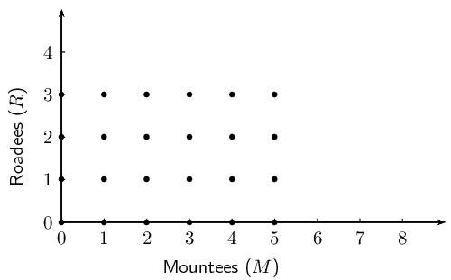
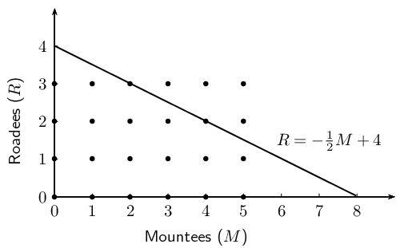
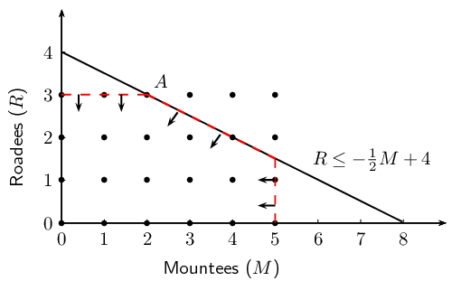
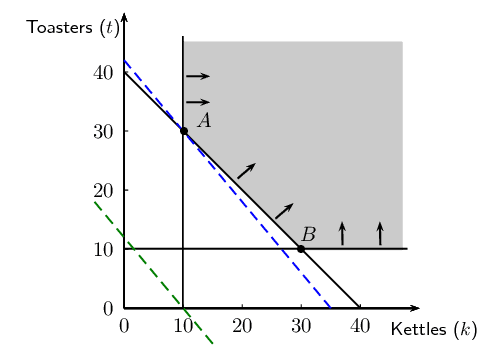

# Chapter 12: Linear programming

## 12.1 Introduction (EMBKK)

- This chapter has been included for enrichment/projects.

In everyday life people are interested in knowing the most efficient way of
carrying out a task or achieving a goal. For example, a farmer wants to know how many hectares to plant during a season in order to maximise the yield (produce), a stock broker wants to know how much to invest in stocks in order to maximise profit, an entrepreneur wants to know how many people to employ to minimise expenditure. These are optimisation problems; we want to to determine either the maximum or the minimum in a specific situation.

To describe this mathematically, we assign variables to represent the different factors that influence the situation. Optimisation means finding the combination of variables that gives the best result.

<Callout type="tip" title="Worked example 1: Mountees and Roadees">
**Question:**
Investigate the following situation and use your knowledge of mathematics to solve the problem:

Mr. Hunter manufactures bicycles. He produces two different models of bicycles; strong mountain bikes called Mountees and fast road bikes called Roadees. He cannot produce more than \(\text{5}\) Mountees on a day and he can manufacture a maximum of \(\text{3}\) Roadees a day. He needs \(\text{1}\) technician to assemble a Mountee and \(\text{2}\) technicians to assemble a Roadee. The company has \(\text{8}\) technicians in the assembly department. The profit on a Mountee is \(\text{R}\,\text{800}\) and \(\text{R}\,\text{2 400}\) on a Roadee. The demand is such that he can sell all the bikes he manufactures.

Determine the number of each model of bicycle that must be manufactured in order to make the maximum profit.

**Assign variables:**
In this situation there are two variables that we need to consider: let the number of Mountees produced be \(M\) and let the number of Roadees produced be \(R\).

**Organise the information given:**
Write down a summary of the information given in the problem so that we consider all the different components in the situation.

\[\begin{array}{l@{\;}l}
          \text{maximum number for } M    &=  5 \\
          \text{maximum number for } R    &=  3 \\
          \text{number of technicians needed for } M    &=  1 \\
          \text{number of technicians needed for } R    &=  2 \\
          \text{total number of technicians } &=  8 \\
          \text{profit per } M &=  \text{800} \\
          \text{profit per } R &=  \text{2 400}
        \end{array}\]

**Draw up a table:**
Use the summary to draw up a table of all the possible combinations of the number of Mountees and Roadees that can be manufactured per day:

| \(M\) | \(R\) |
| --- | --- |
|  | \(\text{0}\) | \(\text{1}\) | \(\text{2}\) | \(\text{3}\) |
| \(\text{0}\) | \((0;0)\) | \((0;1)\) | \((0;2)\) | \((0;3)\) |
| \(\text{1}\) | \((1;0)\) | \((1;1)\) | \((1;2)\) | \((1;3)\) |
| \(\text{2}\) | \((2;0)\) | \((2;1)\) | \((2;2)\) | \((2;3)\) |
| \(\text{3}\) | \((3;0)\) | \((3;1)\) | \((3;2)\) | \((3;3)\) |
| \(\text{4}\) | \((4;0)\) | \((4;1)\) | \((4;2)\) | \((4;3)\) |
| \(\text{5}\) | \((5;0)\) | \((5;1)\) | \((5;2)\) | \((5;3)\) |

Note that there are \(\text{24}\) possible combinations.

**Consider the limitation of the number of technicians:**
It takes \(\text{1}\) technician to assemble a Mountee and \(\text{2}\) technicians to assemble a Roadee. There are a total of \(\text{8}\) technicians in the assembly department, therefore we can write that \(1(M) + 2(R) \leq 8\).

With this limitation, we are able to eliminate some of the combinations in the table where \(M + 2R > 8\):

| \(M\) | \(R\) |
| --- | --- |
|  | \(\text{0}\) | \(\text{1}\) | \(\text{2}\) | \(\text{3}\) |
| \(\text{0}\) | \((0;0)\) | \((0;1)\) | \((0;2)\) | \((0;3)\) |
| \(\text{1}\) | \((1;0)\) | \((1;1)\) | \((1;2)\) | \((1;3)\) |
| \(\text{2}\) | \((2;0)\) | \((2;1)\) | \((2;2)\) | \((2;3)\) |
| \(\text{3}\) | \((3;0)\) | \((3;1)\) | \((3;2)\) | \(\cancel{(3;3)}\) |
| \(\text{4}\) | \((4;0)\) | \((4;1)\) | \((4;2)\) | \(\cancel{(4;3)}\) |
| \(\text{5}\) | \((5;0)\) | \((5;1)\) | \(\cancel{(5;2)}\) | \(\cancel{(5;3)}\) |

These combinations have been excluded as possible answers. For example, \((5;3)\) gives \(5 + 2(3) = 11\) technicians.

**Consider the profit on the bicycles:**
We can express the profit (\(P\)) per day as: \(P = 800(M) + \text{2 400}(R)\). Notice that a higher profit is made on a Roadee.

By substituting the different combinations for \(M\) and \(R\), we can find the values that give the maximum profit:

\begin{align*}
          \text{For } (5;0) \quad P &=  800(5) + \text{2 400}(0) \\
                                                                  &= \text{R}\,\text{4 000} \\
          \text{For } (3;1) \quad P &=  800(3) + \text{2 400}(1) \\
                                                                  &= \text{R}\,\text{4 800}
           \end{align*}

| \(M\) | \(R\) |
| --- | --- |
|  | \(\text{0}\) | \(\text{1}\) | \(\text{2}\) | \(\text{3}\) |
| \(\text{0}\) | \((0;0) \Rightarrow \text{R}\,\text{0}\) | \((0;1) \Rightarrow \text{R}\,\text{2 400}\) | \((0;2) \Rightarrow \text{R}\,\text{4 800}\) | \((0;3) \Rightarrow \text{R}\,\text{7 200}\) |
| \(\text{1}\) | \((1;0) \Rightarrow \text{R}\,\text{800}\) | \((1;1) \Rightarrow \text{R}\,\text{3 200}\) | \((1;2) \Rightarrow \text{R}\,\text{5 600}\) | \((1;3) \Rightarrow \text{R}\,\text{8 000}\) |
| \(\text{2}\) | \((2;0) \Rightarrow \text{R}\,\text{1 600}\) | \((2;1) \Rightarrow \text{R}\,\text{4 000}\) | \((2;2) \Rightarrow \text{R}\,\text{6 400}\) | \((2;3) \Rightarrow \text{R}\,\text{8 800}\) |
| \(\text{3}\) | \((3;0) \Rightarrow \text{R}\,\text{2 400}\) | \((3;1) \Rightarrow \text{R}\,\text{4 800}\) | \((3;2) \Rightarrow \text{R}\,\text{7 200}\) | \(\cancel{(3;3)}\) |
| \(\text{4}\) | \((4;0) \Rightarrow \text{R}\,\text{3 200}\) | \((4;1) \Rightarrow \text{R}\,\text{5 600}\) | \((4;2) \Rightarrow \text{R}\,\text{8 000}\) | \(\cancel{(4;3)}\) |
| \(\text{5}\) | \((5;0) \Rightarrow \text{R}\,\text{4 000}\) | \((5;1) \Rightarrow \text{R}\,\text{6 400}\) | \(\cancel{(5;2)}\) | \(\cancel{(5;3)}\) |

**Write the final answer:**
Therefore the maximum profit of \(\text{R}\,\text{8 800}\) is obtained if \(\text{2}\) Mountees and \(\text{3}\) Roadees are manufactured per day.
</Callout>

## Optimisation

### Textbook Exercise 12.1

**Problem:**
Furniture store opening special:

As part of their opening special, a furniture store has promised to give away at least \(\text{40}\) prizes with a total value of at least \(\text{R}\,\text{4 000}\). They intend to give away kettles and toasters. They decide there will be at least \(\text{10}\) units of each prize. A kettle costs the company \(\text{R}\,\text{120}\) and a toaster costs \(\text{R}\,\text{100}\).

Determine how many of each prize will represent the cheapest option for the company. Calculate how much this combination of kettles and toasters will cost.

Use a suitable strategy to organise the information and solve the problem.

**Solution:**
In this situation there are two variables that we need to consider: let the number of kettles produced be \(K\) and let the number of toasters produced be \(T\).

Write down a summary of the information given in the problem so that we consider all the different components in the situation.

          \[\begin{array}{l@{\;}l}
          \text{minimum number for } K    &=  10 \\
          \text{minimum number for } T    &=  10 \\
          \text{cost of } K    &=  \text{R}\,\text{120} \\
          \text{cost of } T    &=  \text{R}\,\text{100} \\
          \text{minimum number of prizes } &=  40 \\
          \text{minimum total value of prizes } &=  \text{R}\,\text{4 000}
        \end{array}\]

Use the summary to draw up a table of the number of kettles and toasters that are needed. We will consider multiples of 5 to simplify the calculations:

| \(K\) | \(T\) |
| --- | --- |
|  | \(\text{10}\) | \(\text{15}\) | \(\text{20}\) | \(\text{25}\) | \(\text{30}\) |
| \(\text{10}\) | \((10;10)\) | \((10;15)\) | \((10;20)\) | \((10;25)\) | \((10;30)\) |
| \(\text{15}\) | \((15;10)\) | \((15;15)\) | \((15;20)\) | \((15;25)\) | \((15;30)\) |
| \(\text{20}\) | \((20;10)\) | \((20;15)\) | \((20;20)\) | \((20;25)\) | \((20;30)\) |
| \(\text{25}\) | \((25;10)\) | \((25;15)\) | \((25;20)\) | \((25;25)\) | \((25;30)\) |
| \(\text{30}\) | \((30;10)\) | \((30;15)\) | \((30;20)\) | \((30;25)\) | \((30;30)\) |

We need to have at least \(\text{40}\) kettles and toasters together.

With this limitation, we are able to eliminate some of the combinations in the table where \(K + T < 40\):

| \(K\) | \(T\) |
| --- | --- |
|  | \(\text{10}\) | \(\text{15}\) | \(\text{20}\) | \(\text{25}\) | \(\text{30}\) |
| \(\text{10}\) | \(\cancel{(10;10)}\) | \(\cancel{(10;15)}\) | \(\cancel{(10;20)}\) | \(\cancel{(10;25)}\) | \((10;30)\) |
| \(\text{15}\) | \(\cancel{(15;10)}\) | \(\cancel{(15;15)}\) | \(\cancel{(15;20)}\) | \((15;25)\) | \((15;30)\) |
| \(\text{20}\) | \(\cancel{(20;10)}\) | \(\cancel{(20;15)}\) | \((20;20)\) | \((20;25)\) | \((20;30)\) |
| \(\text{25}\) | \(\cancel{(25;10)}\) | \((25;15)\) | \((25;20)\) | \((25;25)\) | \((25;30)\) |
| \(\text{30}\) | \((30;10)\) | \((30;15)\) | \((30;20)\) | \((30;25)\) | \((30;30)\) |

These combinations have been excluded as possible answers.

We can express the minimum cost as: \(C = \text{120}(K) + \text{100}(T)\).

By substituting the different combinations for \(K\) and \(T\), we can find the value that gives the minimum cost.

| \(K\) | \(T\) |
| --- | --- |
|  | \(\text{10}\) | \(\text{15}\) | \(\text{20}\) | \(\text{25}\) | \(\text{30}\) |
| \(\text{10}\) | \(\cancel{(10;10)}\) | \(\cancel{(10;15)}\) | \(\cancel{(10;20)}\) | \(\cancel{(10;25)}\) | \((15;30) \Rightarrow \text{R}\,\text{4 200}\) |
| \(\text{15}\) | \(\cancel{(15;10)}\) | \(\cancel{(15;15)}\) | \(\cancel{(15;20)}\) | \((15;25) \Rightarrow \text{R}\,\text{4 300}\) | \((15;30) \Rightarrow \text{R}\,\text{4 800}\) |
| \(\text{20}\) | \(\cancel{(20;10)}\) | \(\cancel{(20;15)}\) | \((20;20) \Rightarrow \text{R}\,\text{4 400}\) | \((20;25) \Rightarrow \text{R}\,\text{4 900}\) | \((20;30) \Rightarrow \text{R}\,\text{5 400}\) |
| \(\text{25}\) | \(\cancel{(25;10)}\) | \((25;15) \Rightarrow \text{R}\,\text{4 500}\) | \((25;20) \Rightarrow \text{R}\,\text{5 000}\) | \((25;25) \Rightarrow \text{R}\,\text{5 500}\) | \((25;30) \Rightarrow \text{R}\,\text{6 000}\) |
| \(\text{30}\) | \((30;10) \Rightarrow \text{R}\,\text{4 600}\) | \((30;15) \Rightarrow \text{R}\,\text{5 100}\) | \((30;20) \Rightarrow \text{R}\,\text{5 600}\) | \((30;25) \Rightarrow \text{R}\,\text{6 100}\) | \((30;30) \Rightarrow \text{R}\,\text{6 600}\) |

We are looking for a pair of values that give the minimum cost. We can easily check the non-multiples of 5 for kettles and toasters to confirm that \(\text{10}\) kettles and \(\text{30}\) toasters meet the minimum cost.

For example if \(\text{11}\) kettles and \(\text{29}\) toasters are given away, the cost will be \(\text{R}\,\text{4 220}\). And if \(\text{12}\) kettles and \(\text{28}\) toasters are given away, the cost will be \(\text{R}\,\text{4 340}\).

The minimum cost of \(\text{R}\,\text{4 000}\) can be obtained if \(\text{10}\) kettles and \(\text{30}\) toasters are given away. This will result in a cost of \(\text{R}\,\text{4 200}\).

**Optimisation using graphs**

A more efficient way to solve optimisation problems is using graphs.

We write the limitations in the situation, called constraints, as inequalities. Some constraints can be modelled by an equation, which needs to be maximised or minimized. We sketch the inequalities and indicate the region above or below the line that is to be considered in determining the solution. This method of solving optimisation problems is called linear programming.

<Callout type="note" title="Note">
<VideoPlayer src="http://www.khanacademy.org/embed_video?v=unSBFwK881s" title="Video: 23DS" />
</Callout>

<Callout type="tip" title="Worked example 2: Optimisation using graphs">
**Question:**
Consider again the example of Mr. Hunter who manufactures Mountees and Roadees:

Mr. Hunter manufactures bicycles. He produces two different models of bicycles; strong mountain bikes called Mountees and fast road bikes called Roadees. He cannot produce more than \(\text{5}\) Mountees on a day and he can manufacture a maximum of \(\text{3}\) Roadees a day. He needs \(\text{1}\) technician to assemble a Mountee and \(\text{2}\) technicians to assemble a Roadee. The company has \(\text{8}\) technicians in the assembly department. The profit on a Mountee is \(\text{R}\,\text{800}\) and \(\text{R}\,\text{2 400}\) on a Roadee. The demand is such that he can sell all the bikes he manufactures.

Determine the number of each model of bicycle that must be manufactured in order to make a maximum profit.

**Assign variables:**
In this situation there are two variables that we need to consider: let the number of Mountees produced be \(M\) and let the number of Roadees produced be \(R\).

Notice that the values of \(M\) and \(R\) are limited to positive integers; Mr. Hunter cannot sell negative numbers of bikes nor can he sell a fraction of a bike.

**Organise the information:**
We can write these constraints as inequalities:

\begin{align*}
                                \text{number of Mountees: } 0 \leq M &\leq  5 \\
                                \text{number of Roadees: } 0 \leq R &\leq  3 \\
                                \text{total number of technicians: } M + 2R &\leq  8
                                    \end{align*}

We also know that \(P = 800M + \text{2 400}R\). This is called the objective function, sometimes also referred to as the search line, because the objective (goal) is to determine the maximum value of \(P\).

**Solve using graphs:**
We represent the number of Mountees manufactured daily on the horizontal axis and the number of Roadees manufactured daily on the vertical axis. Since \(M\) and \(R\) are positive integers, we only use the first quadrant of the Cartesian plane. Note that the graph only includes the integer values of \(M\) between \(\text{0}\) and \(\text{5}\) and \(R\) between \(\text{0}\) and \(\text{3}\).

For the number of technicians in the assembly department \(M + 2R \leq 8\). If we make \(R\) (represented on the \(y\)-axis) the subject of the inequality we get \(R \leq -\frac{1}{2}M + 4\).

The arrows indicate the region in which the solution will lie, where \(R \leq -\frac{1}{2}M + 4\). This area is called the feasible region.

We substitute the possible combinations into the profit equation \(P = 800M + \text{2 400}R\), and find the combination that gives the maximum profit.

\begin{align*}
    \text{At } A(2;3): \quad P &= 800(2) + \text{2 400}(3)  \\
    &= \text{R}\,\text{8 800}
    \end{align*}

**Write the final answer:**
Therefore the maximum profit is obtained if \(\text{2}\) Mountees and \(\text{3}\) Roadees are manufactured per day.
</Callout>

<Callout type="note" title="Note">
<VideoPlayer src="http://www.khanacademy.org/embed_video?v=CA4S7S-3Lg4" title="Video: 23DT" />
</Callout>

<Callout type="tip" title="Worked example 3: Optimisation using graphs">
**Question:**
Solve the “furniture store opening special” problem using graphs:

As part of their opening special, a furniture store has promised to give away at least \(\text{40}\) prizes. They intend to give away kettles and toasters. They decide there will be at least \(\text{10}\) units of each prize. A kettle costs the company \(\text{R}\,\text{120}\) and a toaster costs \(\text{R}\,\text{100}\).

Determine how many of each prize will represent the cheapest option for the company. Calculate how much this combination of kettles and toasters will cost.

**Assign variables:**
In this situation there are two variables that we need to consider: let the number of kettles be \(k\) and the number of toasters be \(t\), with \(k, t \in \mathbb{Z}\).

**Organise the information:**
We can write the given information as inequalities:

\begin{align*}
        \text{number of kettles: } k &\geq  10 \\
        \text{number of toasters: } t &\geq  10 \\
        \text{total number of prizes: } k + t &\geq  40
        \end{align*}

We make \(t\) the subject of the inequality:
          \[t \geq -k + 40\]

**Solve using graphs:**
Represent the constraints on a set of axes:

We shade the feasible region as shown in the diagram. Remember that in this situation only the points with integer coordinates inside or on the border of the feasible region are possible solutions. The combination giving the minimum cost will lie towards or on the lower border of the feasible region, which gives us many points to consider. To find the optimum value of \(C\), we use the graph of the objective function

\[C = 120k + 100t\]

To draw the line, we make \(t\) the subject of the formula

\[t = -\frac{6}{5}k + \frac{C}{100}\]

We see that the gradient of the objective function is \(-\frac{6}{5}\), but we do not know the exact value of the \(t\)-intercept (\(\frac{C}{100}\)). To find the minimum value of \(C\), we need to determine the position of the objective function where it first touches the feasible region and also gives the lowest \(t\)-intercept.

We indicate the gradient of the objective function on the graph (the green search line). Keeping the gradient the same, we “slide” the objective function towards the lower border of the feasible region and find that it touches the feasible region at point \(A(10;30)\). This optimum position of the objective function is indicated on the graph by the dotted line passing through point \(A\).

We substitute the coordinates of \(A\) into the cost equation \(C = 120k + 100t\):

\begin{align*}
    \text{At } A(10;30): \quad C &= 120(10) + 100(30)  \\
    &= \text{R}\,\text{4 200}
    \end{align*}

The minimum cost can also be determined graphically by reading off the coordinates of the \(t\)-intercept of the objective function in the optimum position:

\begin{align*}
        t_{\text{int}} &= 42  \\
        \therefore \frac{C}{100} &= 42 \\
        \therefore C &= \text{R}\,\text{4 200}
        \end{align*}

**Write the final answer:**
Therefore the minimum cost to the company is \(\text{R}\,\text{4 200}\) with \(\text{10}\) kettles and \(\text{30}\) toasters.
</Callout>
