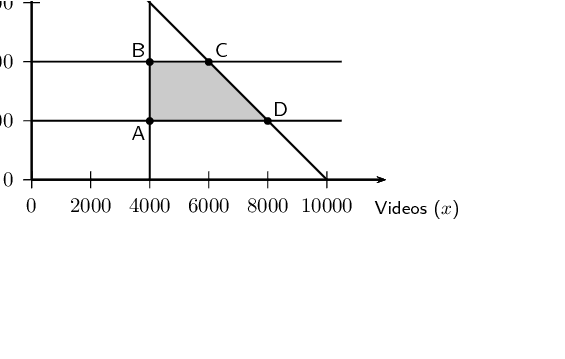
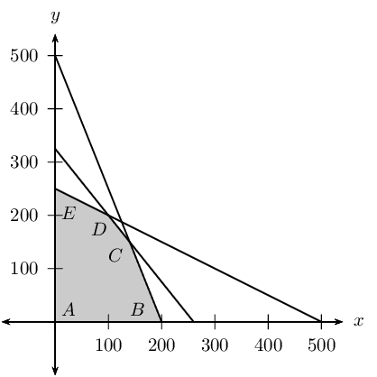
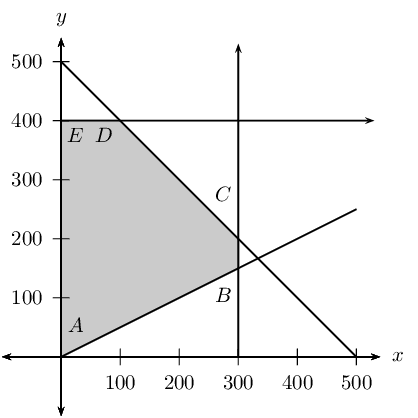
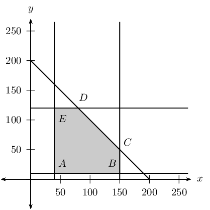
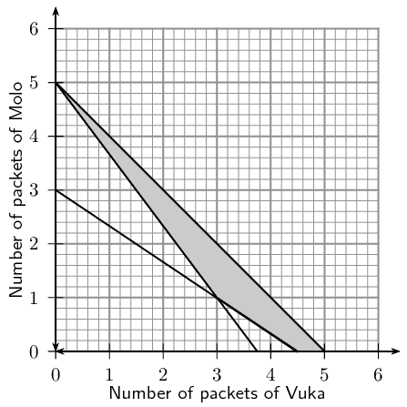

## Optimisation

### Textbook Exercise 12.2

You are given a test consisting of two sections. The first section is on algebra and the second section is on geometry. You are not allowed to answer more than \(\text{10}\) questions from any section, but you have to answer at least \(\text{4}\) algebra questions. The time allowed is not more than \(\text{30}\) minutes. An algebra problem will take \(\text{2}\) minutes and a geometry problem will take \(\text{3}\) minutes to solve.

Let \(x\) be the number of algebra questions and \(y\) be the number of geometry questions.

**Problem:**
Formulate the equations and inequalities that satisfy the above constraints.

**Solution:**
You are not allowed to answer more than \(\text{10}\) questions from any section:

    \begin{align*}
            x & \leq 10 \\
            y & \leq 10
        \end{align*}

You have to answer at least \(\text{4}\) algebra questions:

    \begin{align*}
            x & \geq 4
        \end{align*}

The time allowed is not more than \(\text{30}\) minutes. An algebra problem will take \(\text{2}\) minutes and a geometry problem will take \(\text{3}\) minutes to solve:

    \begin{align*}
            2x + 3y & \leq 30
        \end{align*}

**Problem:**
The algebra questions carry \(\text{5}\) marks each and the geometry questions carry \(\text{10}\) marks each. If \(T\) is the total marks, write down an expression for \(T\).

**Solution:**
\begin{align*}
                T = & (\text{5 marks}) \times (\text{algebra questions answered}) + \\
                & (\text{10 marks}) \times (\text{geometry questions answered}) \\
                T = & 5x + 10y
                \end{align*}

A local clinic wants to produce a guide to healthy living. The clinic intends to produce the guide in two formats: a short video and a printed book. The clinic needs to decide how many of each format to produce for sale. Estimates show that no more than \(\text{10 000}\) copies of both items together will be sold. At least \(\text{4 000}\) copies of the video and at least \(\text{2 000}\) copies of the book could be sold, although sales of the book are not expected to exceed \(\text{4 000}\) copies. Let \(x\) be the number of videos sold, and \(y\) the number of printed books sold.

**Problem:**
Write down the constraint inequalities that can be deduced from the given information.

**Solution:**
Estimates show that no more than \(\text{10 000}\) copies of both items together will be sold:

            \begin{align*}
                x + y & \leq \text{10 000}
                \end{align*}

At least \(\text{4 000}\) copies of the video could be sold:

            \begin{align*}
                x & \geq \text{4 000}
                \end{align*}

At least \(\text{2 000}\) copies of the book could be sold:

            \begin{align*}
                y & \geq \text{2 000}
                \end{align*}

Sales of the book are not expected to exceed \(\text{4 000}\) copies:

            \begin{align*}
                y & \leq \text{4 000}
                \end{align*}

**Problem:**
Represent these inequalities graphically and indicate the feasible region clearly.

**Solution:**

**Problem:**
The clinic is seeking to maximise the income, \(I\), earned from the sales of the two products. Each video will sell for \(\text{R}\,\text{50}\) and each book for \(\text{R}\,\text{30}\). Write down the objective function for the income.

**Solution:**
\begin{align*}
                    I = & (\text{R}\,\text{50}) \times (\text{videos sold}) + \\
                    & (\text{R}\,\text{30}) \times (\text{printed books sold}) \\
                    I = & 50x + 30y
                \end{align*}

**Problem:**
What maximum income will be generated by the two guides?

**Solution:**
The vertices of the feasible region are as follows:

\begin{align*}
                    \text{Point A: } & (\text{4 000};\text{2 000}) \\
                    \text{Point B: } & (\text{4 000};\text{4 000}) \\
                    \text{Point C: } & (\text{6 000};\text{4 000}) \\
                    \text{Point D: } & (\text{8 000};\text{2 000})
                    \end{align*}

The cost at each vertex is as follows:

                    \begin{align*}
                            \text{Point A: } I & = 50(\text{4 000}) + 30(\text{2 000}) = \text{260 000} \\
                            \text{Point B: } I & = 50(\text{4 000}) + 30(\text{4 000}) = \text{320 000} \\
                            \text{Point C: } I & = 50(\text{6 000}) + 30(\text{4 000}) = \text{420 000} \\
                            \text{Point D: } I & = 50(\text{8 000}) + 30(\text{2 000}) = \text{460 000}
                        \end{align*}

The maximum profit of \(\text{R}\,\text{460 000}\) can be made if \(\text{8 000}\) videos and \(\text{2 000}\) books are sold.

A certain motorcycle manufacturer produces two basic models, the Super X and the Super Y. These motorcycles are sold to dealers at a profit of \(\text{R}\,\text{20 000}\) per Super X and \(\text{R}\,\text{10 000}\) per Super Y. A Super X requires \(\text{150}\) hours for assembly, \(\text{50}\) hours for painting and finishing and \(\text{10}\) hours for checking and testing. The Super Y requires \(\text{60}\) hours for assembly, \(\text{40}\) hours for painting and finishing and \(\text{20}\) hours for checking and testing. The total number of hours available per month is: \(\text{30 000}\) in the assembly department, \(\text{13 000}\) in the painting and finishing department and \(\text{5 000}\) in the checking and testing department.

The above information is summarised by the following table:

| Department | Hours for Super X | Hours for Super Y | Hours available per month |
| --- | --- | --- | --- |
| Assembly | \(\text{150}\) | \(\text{60}\) | \(\text{30 000}\) |
| Painting and finishing | \(\text{50}\) | \(\text{40}\) | \(\text{13 000}\) |
| Checking and testing | \(\text{10}\) | \(\text{20}\) | \(\text{5 000}\) |

Let \(x\) be the number of Super X and \(y\) be the number of Super Y models manufactured per month.

**Problem:**
Write down the set of constraint inequalities.

**Solution:**
Adding the assembly hours:

\begin{align*}
                    (150)x + (60)y & \geq \text{30 000}
                    \end{align*}

Adding the painting and finishing:

\begin{align*}
                        (50)x + (40)y& \geq \text{13 000}
                    \end{align*}

Adding the checking and testing:

\begin{align*}
                    (10)x + (20)y & \geq \text{5 000}
                    \end{align*}

**Problem:**
Use graph paper to represent the set of constraint inequalities.

**Solution:**

**Problem:**
Shade the feasible region on the graph paper.

**Solution:**
See above

**Problem:**
Write down the profit generated in terms of \(x\) and \(y\).

**Solution:**
\begin{align*}
                    E = & (\text{profit per Super X}) \times (\text{number of Super X bikes sold}) + (\text{profit per Super Y}) \times (\text{number of Super Y bikes sold})\\
                    E = & (\text{20 000})x + (\text{10 000})y
                \end{align*}

**Problem:**
How many motorcycles of each model must be produced in order to maximise the monthly profit?

**Solution:**
The vertices of the feasible region are as follows:

\begin{align*}
                        \text{Point A: } & (\text{0};\text{0}) \\
                        \text{Point B: } & (\text{200};\text{0}) \\
                        \text{Point C: } & (\text{140};\text{150}) \\
                        \text{Point D: } & (\text{100};\text{200}) \\
                        \text{Point E: } & (\text{0};\text{250})
                    \end{align*}

The cost at each vertex is as follows:

\begin{align*}
                        \text{Point A: } E & = \text{20 000}(\text{0}) + \text{10 000}(\text{0}) = \text{0} \\
                        \text{Point B: } E & = \text{20 000}(\text{200}) + \text{10 000}(\text{0}) = \text{4 000 000} \\
                        \text{Point C: } E & = \text{20 000}(\text{140}) + \text{10 000}(\text{150}) = \text{4 300 000} \\
                        \text{Point D: } E & = \text{20 000}(\text{100}) + \text{10 000}(\text{200}) = \text{4 000 000} \\
                        \text{Point E: } E & = \text{20 000}(\text{0}) + \text{10 000}(\text{250}) = \text{2 500 000}
                    \end{align*}

To maximize the objective function select **Point C**.

The maximum profit can be made if **\(\text{140}\)** Super X motorbikes and **\(\text{150}\)** Super Y motorbikes are sold.

**Problem:**
What is the maximum monthly profit?

**Solution:**
The maximum possible profit is \(\text{R}\,\text{4 300 000}\).

A group of students plan to sell \(x\) hamburgers and \(y\) chicken burgers at a rugby match. They have meat for at most \(\text{300}\) hamburgers and at most \(\text{400}\) chicken burgers. Each burger of both types is sold in a packet. There are \(\text{500}\) packets available. The demand is likely to be such that the number of chicken burgers sold is at least half the number of hamburgers sold.

**Problem:**
Write the constraint inequalities and draw a graph of the feasible region.

**Solution:**
They have meat for at most 300 hamburgers:

\begin{align*}
            x \leq \text{300}
            \end{align*}

They have meat for at most 400 chicken burgers:

\begin{align*}
            y \leq \text{400}
            \end{align*}

The demand is likely to be such that the number of chicken burgers sold is at least half the number of hamburgers sold:

\begin{align*}
            y & \geq (0.5) x
            \end{align*}

Each burger of both types is sold in a packet. There are 500 packets available:

\begin{align*}
            x + y & \leq 500
            \end{align*}

**Problem:**
A profit of \(\text{R}\,\text{3}\) is made on each hamburger sold and \(\text{R}\,\text{2}\) on each chicken burger sold. Write the equation which represents the total profit \(P\) in terms of \(x\) and \(y\).

**Solution:**
\begin{align*}
                P = & (\text{profit per hamburger}) \times (\text{number of hamburgers sold}) + (\text{profit per chicken burger}) \times (\text{number of chicken burgers sold})\\
                P = & (\text{3})x + (\text{2})y
                \end{align*}

**Problem:**
The objective is to maximise profit. How many of each type of burger should be sold?

**Solution:**
The vertices of the feasible region are as follows:

\begin{align*}
                \text{Point A: } & (\text{0};\text{0}) \\
                \text{Point B: } & (\text{300};\text{150}) \\
                \text{Point C: } & (\text{300};\text{200}) \\
                \text{Point D: } & (\text{100};\text{400}) \\
                \text{Point E: } & (\text{0};\text{400})
                \end{align*}

The cost at each vertex is as follows:

\begin{align*}
                \text{Point A: } P & = \text{3}(\text{0}) + \text{2}(\text{0}) = \text{0} \\
                \text{Point B: } P & = \text{3}(\text{300}) + \text{2}(\text{150}) = \text{1 200} \\
                \text{Point C: } P & = \text{3}(\text{300}) + \text{2}(\text{200}) = \text{1 300} \\
                \text{Point D: } P & = \text{3}(\text{100}) + \text{2}(\text{400}) = \text{1 100} \\
                \text{Point E: } P & = \text{3}(\text{0}) + \text{2}(\text{400}) = \text{800}
                \end{align*}

To maximize the objective function select **Point C**.

The maximum possible profit of **\(\text{R}\,\text{1 300}\)** can be made if \(\text{300}\) hamburgers and \(\text{200}\) chicken burgers are sold.

Fashion-Cards is a small company that makes two types of cards, type X and type Y. With the available labour and material, the company can make at most \(\text{150}\) cards of type X and at most \(\text{120}\) cards of type Y per week. Altogether they cannot make more than \(\text{200}\) cards per week.

There is an order for at least \(\text{40}\) type X cards and \(\text{10}\) type Y cards per week. Fashion-Cards makes a profit of \(\text{R}\,\text{5}\) for each type X card sold and \(\text{R}\,\text{10}\) for each type Y card.

Let the number of type X cards manufactured per week be \(x\) and the number of type Y cards manufactured per week be \(y\).

**Problem:**
One of the constraint inequalities which represents the restrictions above is \(0 \leq x \leq 150\). Write the other constraint inequalities.

**Solution:**
The company can not make more than \(\text{150}\) cards of type X per week:
      \[x \leq \text{150}\]

The company can make not more than \(\text{120}\) cards of type Y per week:
      \[y \leq \text{120}\]

Altogether they cannot make more than \(\text{200}\) cards per week:
      \[x + y \leq 200\]

There is an order for at least \(\text{40}\) type X cards and \(\text{10}\) type Y cards per week:
      \begin{align*}
    x & \geq 40 \\
    y & \geq 10
    \end{align*}

**Problem:**
Represent the constraints graphically and shade the feasible region.

**Solution:**

**Problem:**
Write the equation that represents the profit \(P\) (the objective function), in terms of \(x\) and \(y\).

**Solution:**
\begin{align*}
                P = & (\text{profit per card X}) \times (\text{number of card X sold}) + (\text{profit per card Y}) \times (\text{number of card Y sold})\\
                P = & (\text{5})x + (\text{10})y
                \end{align*}

**Problem:**
Calculate the maximum weekly profit.

**Solution:**
The vertices of the feasible region are as follows:

\begin{align*}
                \text{Point A: } & (\text{40};\text{10}) \\
                \text{Point B: } & (\text{150};\text{10}) \\
                \text{Point C: } & (\text{150};\text{50}) \\
                \text{Point D: } & (\text{80};\text{120}) \\
                \text{Point E: } & (\text{40};\text{120})
                \end{align*}

The cost at each vertex is as follows:

\begin{align*}
                \text{Point A: } P & = \text{5}(\text{40}) + \text{10}(\text{10}) = \text{300} \\
                \text{Point B: } P & = \text{5}(\text{150}) + \text{10}(\text{10}) = \text{850} \\
                \text{Point C: } P & = \text{5}(\text{150}) + \text{10}(\text{50}) = \text{1 250} \\
                \text{Point D: } P & = \text{5}(\text{80}) + \text{10}(\text{120}) = \text{1 600} \\
                \text{Point E: } P & = \text{5}(\text{40}) + \text{10}(\text{120}) = \text{1 400}
                \end{align*}

To maximize the objective function select **Point D**.

The maximum possible weekly profit of **\(\text{R}\,\text{1 600}\)** can be made if \(\text{80}\) of card X and \(\text{120}\) of card Y are sold.

To meet the requirements of a specialised diet a meal is prepared by mixing two types of cereal, Vuka and Molo. The mixture must contain \(x\) packets of Vuka cereal and \(y\) packets of Molo cereal. The meal requires at least \(\text{15}\) \(\text{g}\) of protein and at least \(\text{72}\) \(\text{g}\) of carbohydrates. Each packet of Vuka cereal contains \(\text{4}\) \(\text{g}\) of protein and \(\text{16}\) \(\text{g}\) of carbohydrates. Each packet of Molo cereal contains \(\text{3}\) \(\text{g}\) of protein and \(\text{24}\) \(\text{g}\) of carbohydrates. There are at most \(\text{5}\) packets of cereal available. The feasible region is shaded on the attached graph paper.

**Problem:**
Write down the constraint inequalities.

**Solution:**
Adding the protein:

\begin{align*}
                (4)x + (3)y \geq \text{15}
                \end{align*}

Adding the carbohydrates:

\begin{align*}
                (16)x + (24)y \geq \text{72}
                \end{align*}

There are at most 5 packets of cereal available:

\begin{align*}
                x + y & \leq 5
                \end{align*}

**Problem:**
If Vuka cereal costs \(\text{R}\,\text{6}\) per packet and Molo cereal also costs \(\text{R}\,\text{6}\) per packet, use the graph to determine how many packets of each cereal must be used so that the total cost for the mixture is a minimum.

**Solution:**
The objective function can be written as follows:

\begin{align*}
                P = & (\text{profit per packet of Vuka}) \times (\text{number of packets of Vuka}) + (\text{profit per packet of Molo}) \times (\text{number of packets of Molo})\\
                P = & (\text{6})x + (\text{6})y
                \end{align*}

The vertices of the feasible region are as follows:

\begin{align*}
                \text{Point A: } & (\text{3};\text{1}) \\
                \text{Point B: } & (\text{4,5};\text{0}) \\
                \text{Point C: } & (\text{5};\text{0}) \\
                \text{Point D: } & (\text{0};\text{5})
                \end{align*}

The cost at each vertex is as follows:

\begin{align*}
                \text{Point A: } P & = \text{6}(\text{3}) + \text{6}(\text{1}) = \text{24} \\
                \text{Point B: } P & = \text{6}(\text{4,5}) + \text{6}(\text{0}) = \text{27} \\
                \text{Point C: } P & = \text{6}(\text{5}) + \text{6}(\text{0}) = \text{30} \\
                \text{Point D: } P & = \text{6}(\text{0}) + \text{6}(\text{5}) = \text{30}
                \end{align*}

To minimize the objective function select Point A. The minimum possible cost of \(\text{R}\,\text{24}\) can be made if \(\text{3}\) packets of Vuka and \(\text{1}\) packets of Molo are sold.

**Problem:**
Use the graph to determine how many packets of each cereal must be used so that the total cost for the mixture is a maximum (give all possibilities).

**Solution:**
To maximize the objective function select Point C, or Point D. The maximum possible cost of \(\text{R}\,\text{30}\) can be made if either \(\text{5}\) packets of Vuka and \(\text{0}\) packets of Molo are sold, or \(\text{0}\) packets of Vuka and \(\text{5}\) packets of Molo are sold.
